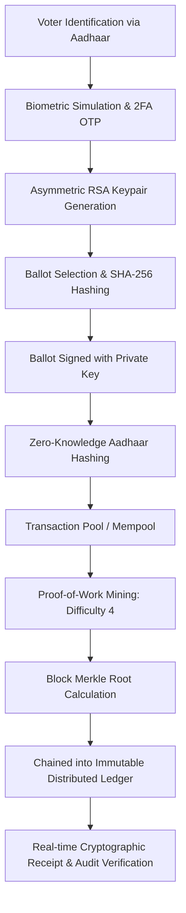

# 🗳️ BlockVote — Cryptographic Blockchain E-Voting System

[](https://blockchain-based-e-voting-system-61.vercel.app)
[](https://www.python.org/)
[](https://flask.palletsprojects.com/)
[](https://opensource.org/licenses/MIT)

A verifiable, decentralized digital voting platform engineered with **custom SHA-256 blockchain architecture**, **Proof-of-Work (PoW) consensus**, **Merkle Tree transaction integrity**, **Asymmetric RSA ballot signing**, and **Zero-Knowledge identity protection**.

🌐 **Production Deployment:** [https://blockchain-based-e-voting-system-61.vercel.app](https://blockchain-based-e-voting-system-61.vercel.app)

---

## 📌 Architectural Overview

Traditional electoral architectures suffer from central points of failure, lack of independent voter auditability, and vulnerability to retroactive database tampering. **BlockVote** models a cryptographically verifiable alternative:



### 🔒 Core Security & Cryptographic Pillars

* **SHA-256 Immutable Ledger**: Every block contains the hash of the preceding block header. Modifying a historical block invalidates all forward hashes across the chain.
* **Proof-of-Work Consensus**: Block finality requires discovering a mathematical `nonce` resulting in a block hash starting with `0000` (`DIFFICULTY = 4`).
* **Merkle Root Validation**: Transaction batches are pairwise-hashed up to a single Merkle Root per block, enabling logarithmic verification speed.
* **Pure-Python Asymmetric RSA Signing**: Voters are issued ephemeral RSA keypairs. Ballots are cryptographically signed with the voter's private key and mathematically validated against public keys before block inclusion.
* **Zero-Knowledge Voter Privacy**: Plaintext Aadhaar identities are never committed to blocks; only salted SHA-256 hash digests (`aadhaar_hash`) persist on-chain.
* **Self-Healing & Attack Simulation**: Built-in security testing tools allow deliberate payload tampering of mined blocks to illustrate real-time validation breakdowns and automatic ledger restoration from backups.

---

## 🛠️ Technology Stack

| Layer | Technologies |
| :--- | :--- |
| **Backend** | Python 3.10+, Flask, Jinja2 |
| **Cryptography** | SHA-256 (`hashlib`), Custom RSA Keypair & Signature Engine, Merkle Trees |
| **Frontend** | Vanilla JavaScript (ES6+), Glassmorphism CSS, Chart.js, Canvas Particles |
| **Email & Delivery** | Python `smtplib` (Dual-protocol: Port 587 STARTTLS / Port 465 SSL) + Automatic Demo Fallbacks |
| **Deployment** | Vercel Serverless (`@vercel/python`) |

---

## 🚀 Getting Started

### Prerequisites

* Python `3.9+`
* `pip`

### 1. Clone & Set Up

```bash
git clone https://github.com/HeetSoni26/Blockchain-based-E-voting-system.git
cd Blockchain-based-E-voting-system
```

### 2. Environment Configuration (Optional for Live SMTP)

Create a `.env` file in the root directory (or configure environment variables in your deployment host):

```env
# Optional: Live Gmail SMTP Configuration
SMTP_EMAIL=your_email@gmail.com
SMTP_PASSWORD=your_16_character_app_password
SECRET_KEY=your_custom_flask_secret_key
```

> **Note on Resilient Fallback Mode:**  
> If SMTP credentials are not configured or email delivery is restricted, BlockVote automatically switches to **Resilient Demo Mode** — presenting OTPs and RSA private keys directly in the UI so user testing and end-to-end evaluation are never interrupted.

### 3. Install & Run Locally

```bash
pip install -r requirements.txt
python app.py
```

Visit `http://127.0.0.1:5000` in your web browser.

---

## 🔐 Mock Voter Credentials

For demonstration, the system includes 10 pre-configured identity records:

| Aadhaar Number | Voter Name | Regional Constituency |
| :--- | :--- | :--- |
| `1234 5678 9012` | Arjun Sharma | New Delhi |
| `2345 6789 0123` | Priya Patel | Ahmedabad, Gujarat |
| `3456 7890 1234` | Rahul Verma | Mumbai, Maharashtra |
| `4567 8901 2345` | Sunita Reddy | Hyderabad, Telangana |
| `5678 9012 3456` | Amit Kumar | Kolkata, West Bengal |
| `6789 0123 4567` | Deepika Singh | Chennai, Tamil Nadu |
| `7890 1234 5678` | Vikram Nair | Kochi, Kerala |
| `8901 2345 6789` | Kavya Joshi | Pune, Maharashtra |
| `9012 3456 7890` | Suresh Gupta | Jaipur, Rajasthan |
| `0123 4567 8901` | Meera Iyer | Bengaluru, Karnataka |

---

## 📋 Comprehensive Voting & Verification Flow

1. **Authentication (`/verify`)**: Enter a registered Aadhaar number. Complete the simulated biometric scanner (retina & fingerprint matching).
2. **2FA OTP Issuance**: An OTP is dispatched via SMTP (or fallback display). Entering the 6-digit code verifies voter session authenticity.
3. **Key Generation**: The system generates a cryptographic 128-bit RSA keypair, providing the voter with their private key.
4. **Cast Ballot (`/vote`)**: Select a candidate/party (`BJP`, `Congress`, `AAP`, `NOTA`, `Independent`). Confirm and cryptographically sign the ballot with your private key.
5. **Mining & Consensus (`/mining`)**: Pending vote transactions are packed into a block and mined via Proof-of-Work.
6. **Audit & Verification (`/audit`)**: Input your unique **Ballot Hash** or **Digital Signature** to verify that your vote remains untampered in the public ledger.

---

## 🛡️ Administrative & Attack Simulation Suite (`/admin`)

The system provides an administrative control center for research and demonstrations:

* **Cyber-Security Tamper Simulator**: Manually alter candidate votes within committed blocks to simulate database corruption or malicious administrator attacks. Observe real-time chain invalidation.
* **Self-Healing Ledger Recovery**: Restore ledger integrity from secure cryptographic backups with one click.
* **SMTP Diagnostic & Testing Utility**: Test SMTP connections live (STARTTLS/SSL) with detailed server error reporting (including `535 Bad Credentials` diagnostics).
* **Emergency Ledger Reset**: Secure, OTP-gated wipe of experimental blocks to reset the voting environment.

---

## ☁️ Deploying to Vercel

The project includes pre-configured [`vercel.json`](./vercel.json) build specifications:

1. Push your fork or repository to GitHub.
2. Import the project into your [Vercel Dashboard](https://vercel.com).
3. Under **Project Settings → Environment Variables**, add:
   * `SMTP_EMAIL`: Your Gmail address.
   * `SMTP_PASSWORD`: Your 16-character [Google App Password](https://myaccount.google.com/apppasswords).
   * `SECRET_KEY`: A random secure string.
4. Click **Deploy**.

---

## 📄 License & Disclaimer

* **License**: Released under the [MIT License](LICENSE).
* **Educational Disclaimer**: This system is designed for **academic research, educational demonstrations, and hackathon evaluation**. It is not intended for official government or municipal elections without integration with certified hardware security modules (HSM) and regulated multi-party consensus nodes.
